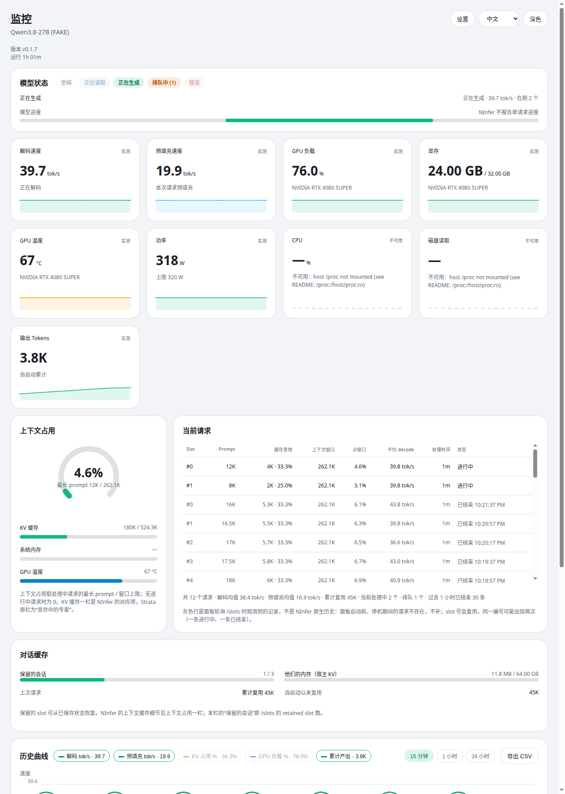
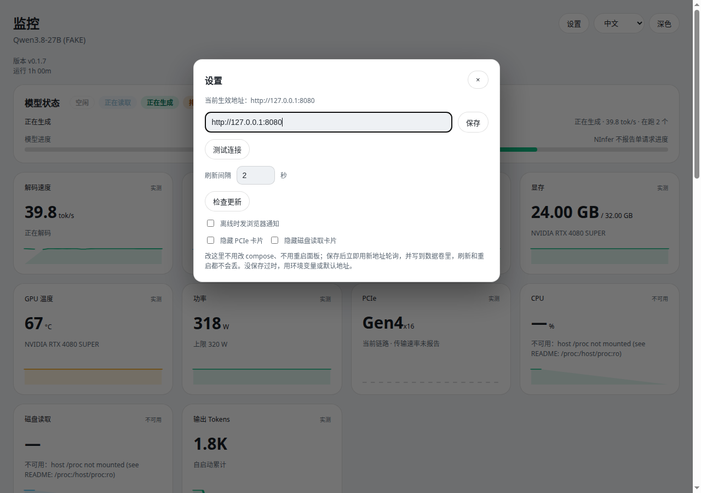
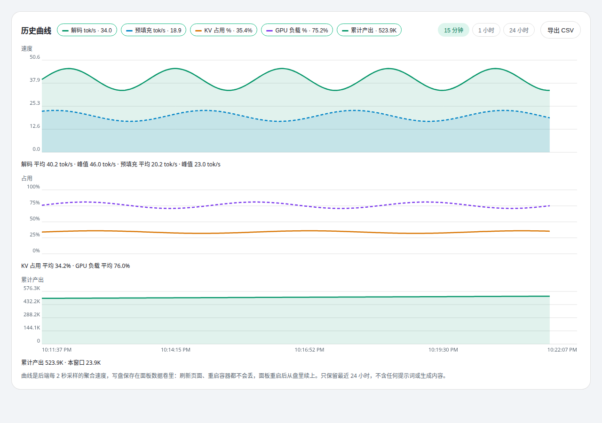

# NInfer Live Panel

[中文](./README.md) | English

A read-only live panel for an already-running NInfer server. It deploys, downloads, and starts no inference framework.

- **GET only, no POST**: it polls `/health`, `/v1/load`, `/stats`, `/metrics`, and `/slots`. No chat, no generation, no model load/unload, no NInfer configuration changes. If NInfer is offline, the panel just shows offline; it never starts NInfer for you.
- **Image**: `ghcr.io/izerok/ninfer-live-panel:latest` (built and pushed by GitHub Actions on every push to main).

## Screenshots

The images below are the real panel UI (light theme, Chinese UI). The data is simulated (the model name carries `(FAKE)`); the CPU / disk cards show "unavailable" because the screenshot environment had no host `/proc` mount. The main panel hides the PCIe card (re-enable it from Settings).

<table>
  <tr>
    <td align="center"><br>Main panel</td>
    <td align="center"><br>Settings dialog</td>
  </tr>
  <tr>
    <td colspan="2" align="center"><br>History, three panels: speed / usage / cumulative output (15 minutes by default)</td>
  </tr>
</table>

## Quick start

```bash
docker compose up -d
```

Open http://127.0.0.1:8091/ . The panel is published to the host loopback only by default; do not change it to `0.0.0.0` for public exposure (see [Security](#security)).

```bash
# Without compose:
docker run -d --name ninfer-panel -p 127.0.0.1:8091:8091 \
  -v ninfer-panel-data:/app/data \
  ghcr.io/izerok/ninfer-live-panel:latest

# From source (Python 3.12, no third-party dependencies):
python3 app.py
```

## What is on screen

| Section | Content |
| --- | --- |
| Model state | Five states: idle / reading / generating / queued / error (NInfer has no single state field; mapped from running / waiting / prefilling / decode_ready). |
| Metric cards | Decode, prefill, GPU load, VRAM, temperature, power, PCIe, CPU, disk read, output tokens (cumulative decode count since startup). Sparklines resume from backend history after refresh (PCIe has link info only, so its sparkline stays dashed; PCIe and disk read can be hidden from Settings). |
| Current requests | Top rows are in-flight slots: slot id, prompt length, cached portion (length · share of prompt), context window, share of window, "In flight". Grey rows below are requests observed ending in the past hour ("Ended HH:MM"); lengths only; slot ids are reused. Queued requests are a count only. Each row adds average decode and duration: average decode is the panel-wide average decode rate over the request's processing window (not the request's own speed — NInfer reports no per-request output); duration is the observed first-to-last span, or elapsed time while in flight. The table body is capped at 320px and scrolls internally; the totals line stays outside the scroll area and always visible. |
| Context usage | Longest in-flight prompt / window limit (`capacity.max_context` from `/v1/load`), plus KV cache, system memory, and GPU temperature rows. |
| Conversation cache | Retained slot count and host KV, plus cumulative reused tokens. |
| History | Three stacked panels sharing one time axis: speed (decode, prefill tok/s), usage (KV, GPU %, lines only, no fill), and cumulative output (cumulative decode tokens, breaking — not cliffing — when an NInfer restart resets the counter). Five legend dimensions toggle (stored in the browser) with latest values; turning off every dimension of a panel hides that panel; each panel has its own window stats (speed: average/peak; usage: average; cumulative output: “Cumulative X · This window Y”); the second line in a panel is dashed, so series are never distinguished by color alone. Default range 15 minutes; switches to 1 hour / 24 hours (plus 7 days when retention reaches it); hover shows values at that moment; Export CSV columns follow the legend selection (the cumulative column appears only when that dimension is on). Sampled every 2 seconds and persisted to disk, so it survives refreshes, restarts, and recreates (with the data volume mounted); only the last 24 hours are kept (configurable). When the data span is shorter than the window, the axis fits the data so the curve always fills the chart, and time ticks adapt to the span. |
| State events | State changes seen by backend polling (time, old → new, reason), capped at 200 entries in the data volume; the curve marks each moment with a vertical line (offline red, recovery green, other grey). |

## Settings

The top-right Settings dialog edits the NInfer address; saving takes effect immediately — no compose edit, no restart. Precedence: **UI-saved > `NINFER_BASE_URL` > image default**. It also offers Test connection (`/health` only, no API key, never auto-saves), a refresh interval (1–10 s, display only), a manual Check for updates (bypasses the 1-hour cache), "Notify in browser when offline" (off by default), and "Hide PCIe card" and "Hide disk read card" (both off by default, this browser's view only). The saved value lives in `settings.json`.

Top-right buttons switch dark / light and 中文 / English, stored in browser `localStorage`; before a choice, the theme follows the system and the language follows the browser. All UI strings come from one dictionary in `web/i18n.js`; `web/index.html` contains none.

## Data sources and definitions

| Endpoint | Used for |
| --- | --- |
| `/health` | Online or not, version |
| `/v1/load` | Model, uptime, capacity, admitted / running / waiting / prefilling / decode_ready, KV usage, cumulative counts |
| `/stats` | Cumulative averages, queue depth, peak admitted |
| `/metrics` | Requests completed / failed / rejected, KV usage ratio, draft accept rate, cumulative average speeds |
| `/slots` | Slot totals, in-flight and retained counts; in-flight slots' prompt lengths and cached portions |
| `nvidia-smi` | GPU load, VRAM, temperature, power (needs the NVIDIA container toolkit and GPU passthrough; otherwise unavailable) |
| Host `/proc` (read-only mount) | System memory, CPU, disk throughput (without the mount: unavailable; container numbers are never substituted) |

Three speeds, kept apart: **instant** ((this − last) / interval from counters sampled every 2 seconds), **15-minute average** (counter samples kept for 900 seconds), **cumulative average** (NInfer's own since-startup average from `/metrics` / `/stats`).

## What is deliberately not invented

Fields that exist in Strata but not in NInfer are never fabricated:

- **Per-request progress**: `/slots` does not report it, so the progress bar only animates while reading / generating, never showing a fake percentage.
- **Request history**: NInfer has no history API, so the grey rows are records the panel itself observed by polling `/slots` in the past hour, not native history; requests from before the panel started or while it was down do not exist and are not backfilled.
- **Experts in VRAM**: a Strata MoE cache concept that NInfer does not have; the context section uses NInfer's KV cache instead.
- **PCIe transfer rate**: not reported by NInfer, and a single `nvidia-smi` query only gives link generation / width, so the PCIe card shows the link and says the rate is not reported.
- **Generated token counts**: `/slots` has none, so the current-requests table shows prompt length only, not output tokens.
- **Unreachable fields**: shown as "unavailable", never as 0 (0 would be misread as a measured value).

## Number display rules (display only, values unchanged)

- Speed is always `tok/s`, never `t/s`; decode at or above 1000 shortens to `k tok/s` (e.g. 1.23k tok/s), prefill is always raw, never shortened to k (e.g. 1245.3 tok/s).
- The cached column shows "length · share of prompt" (for example 4K · 33.3%).
- Token counts at or above 1000 shorten to K/M (e.g. 12K, 262.1K); the exact value stays in the hover tooltip and raw `/api/snapshot` numbers.
- Bytes auto-scale B / KB / MB / GB; at or above 1024 MB/s the rate switches to GB/s; percentages always 1 decimal; uptime `1h 00m` / `45m` / `30s`.

## Configuration

| Variable | Default | Notes |
| --- | --- | --- |
| `NINFER_BASE_URL` | `http://host.docker.internal:8080` | NInfer address on first run; ignored once an address is saved in the UI |
| `NINFER_API_KEY` | empty | Only if NInfer was started with an API key; the backend sends it as a Bearer token to read endpoints and never puts it in a snapshot or the frontend |
| `PANEL_BIND` / `PANEL_PORT` | `0.0.0.0` / `8091` | In-container listen address and port; public exposure is controlled by compose's `127.0.0.1:8091:8091` mapping |
| `POLL_INTERVAL` | `2` | Backend poll interval in seconds |
| `PANEL_HISTORY_FILE` | `/app/data/history.jsonl` | History curve file; events, request records, and settings live in the same directory |
| `PANEL_HISTORY_RETENTION_SECONDS` | `86400` | History retention in seconds; the history range cap follows it — set 604800 for the 7-day range |
| `PANEL_UPDATE_CHECK` | `1` | Set to `0` to disable the upgrade check (offline hosts) |
| `VERSION` (file) | repo root | Current version; image and Release tags come from it |

## Version, upgrade check, and release flow

- The panel header shows the `VERSION` file's version; the image is tagged `:latest` and `:v<VERSION>`.
- Upgrade check: once an hour (cached for 1 hour) the panel asks the public GitHub Releases API for this repository's latest release — a public record only, no token, no panel data. If the check fails, the banner simply stays hidden; when a newer release exists, a banner appears at the top with a link.
- Change flow: `main` is protected; changes go through a PR: branch → push branch → open PR → at least 1 approval + the `build-and-push` check passing → merge. After merging to main, Docker Publish builds and pushes the image, and on success the Release workflow creates a Release automatically (skipped when `VERSION` did not change).

## Security

See [SECURITY.md](./SECURITY.md) for the full statement. The essentials:

- `/api/snapshot` has no authentication: anyone who can open port 8091 can see the model name, request counts, GPU and host metrics, and in-flight requests' prompt **lengths** (lengths only, not content). That is why the default publish is loopback-only; before exposing it publicly, put an authenticated reverse proxy of your own in front. TLS alone is not authentication.
- Inside the container the panel runs as non-root (uid/gid 10001), with no privileges, no host networking, and no Docker socket mount.
- The GitHub Actions workflow logs in to GHCR with the repository's own `GITHUB_TOKEN` only, with permissions narrowed to `contents: read` + `packages: write`, and prints no secrets to logs.

## Troubleshooting

| Symptom | Check first |
| --- | --- |
| Panel opens but everything is offline | Confirm NInfer is running and `curl http://127.0.0.1:8080/health` answers on the host, then check the address in Settings |
| GPU cards say unavailable | The host lacks the NVIDIA container toolkit, or GPU passthrough was removed from compose; NInfer numbers still work, just without GPU cards |
| System memory says unavailable | Host `/proc` is not mounted; compose mounts `/proc:/host/proc:ro` by default, and removing it makes memory unavailable rather than substituted |
| Instant speed is occasionally 0 while generating | No new tokens were committed between two samples; this is real behavior — judge it together with the cumulative average and the curve |
| History curve is empty | Normal for the first two samples after startup; if still empty after a minute, check the data volume mount and panel log for write errors (a write failure falls back to memory-only history and does not break the main panel) |

## Layout source and development

The layout replicates the `apps/host` Monitor screen of Niko1221/Strata (MIT licensed), with the data source swapped to a local NInfer server. This project is not affiliated with Strata or with NInfer upstream.

```bash
# Frontend changes take effect on page refresh (app.py serves the static page fresh each time)
# After backend changes, restart app.py; syntax check:
python3 -m py_compile app.py
```

Real-machine verification passed: confirmed by the user on the ninfer-unc host, with no issues.
