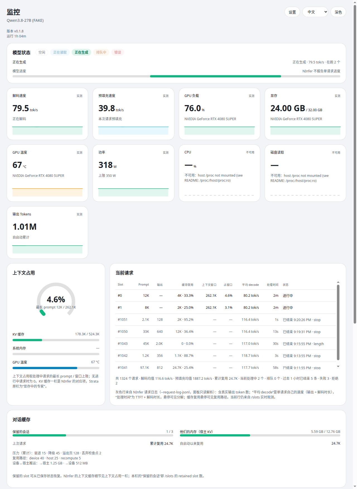
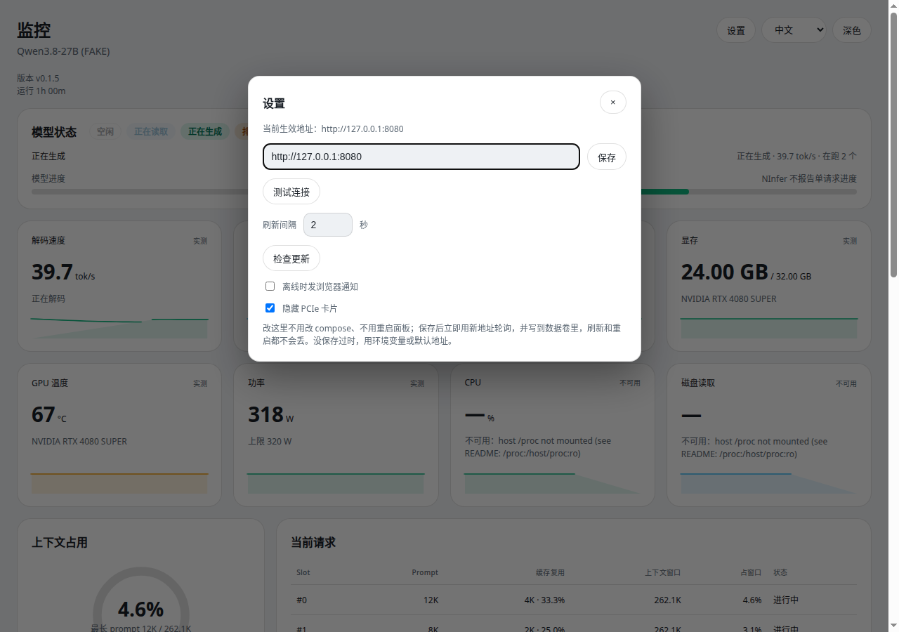
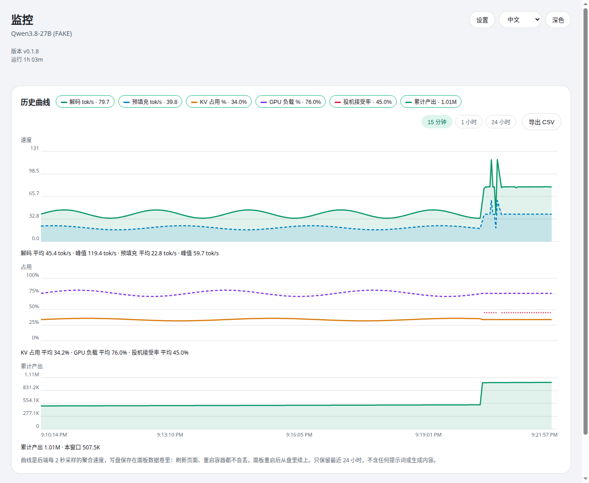

# NInfer Live Panel

[English](./README.en.md) | 中文

只读实时面板：看一台已经在跑的 NInfer，不部署、不下载、不启动任何推理框架。

- **只 GET，不 POST**：轮询 `/health`、`/v1/load`、`/stats`、`/metrics`、`/slots`，不聊天、不生成、不加载、不卸载、不改配置。NInfer 离线时只显示离线，不会替你把它拉起来。
- **镜像**：`ghcr.io/izerok/ninfer-live-panel:latest`（push 到 main 后由 GitHub Actions 自动构建推送）。

## 效果图

真实界面（浅色主题、中文界面），数据是模拟 NInfer（模型名带 `(FAKE)`）；CPU / 磁盘卡片显示“不可用”是因为截图环境没有挂载宿主 `/proc`。主面板的 PCIe 卡已隐藏（设置里可恢复）。

<table>
  <tr>
    <td align="center"><br>主面板</td>
    <td align="center"><br>设置弹窗</td>
  </tr>
  <tr>
    <td colspan="2" align="center"><br>历史曲线三面板：速度 / 占用 / 累计产出（默认 15 分钟）</td>
  </tr>
</table>

## 快速开始

```bash
docker compose up -d
```

打开 http://127.0.0.1:8091/ 。面板默认只发布到宿主回环地址，不要改成 `0.0.0.0` 对外发布（见[安全](#安全)）。

```bash
# 不用 compose，直接拉镜像跑：
docker run -d --name ninfer-panel -p 127.0.0.1:8091:8091 \
  -v ninfer-panel-data:/app/data \
  ghcr.io/izerok/ninfer-live-panel:latest

# 从源码跑（只要 Python 3.12，无第三方依赖）：
python3 app.py
```

## 界面一览

| 区域 | 内容 |
| --- | --- |
| 模型状态 | 五态：空闲 / 正在读取 / 正在生成 / 排队中 / 错误（NInfer 无单一状态字段，按 running / waiting / prefilling / decode_ready 映射）。 |
| 指标卡 | 解码、预填充、GPU 负载、显存、温度、功率、PCIe、CPU、磁盘读取、输出 Tokens（自启动累计 decode 计数）；迷你曲线刷新后从后端历史续上（PCIe 只有链路，曲线恒为虚线；PCIe、磁盘读取可在设置里隐藏）。 |
| 当前请求 | 上半是处理中的 slot：slot 号、prompt 长度、输出（进行中无此数）、缓存复用（长度 · 占 prompt 比例）、窗口、占窗口比、平均 decode、处理时间、“进行中”。下半灰色行是过去 1 小时的已结束请求，默认来源是面板对 /slots 的观测记录（只含长度，slot 号会复用）：平均 decode 是该请求处理时段内面板整体的平均解码速率（不是单请求自己的速度），处理时间是观测到的首末时间差。若给 NInfer 加了 `--request-log-jsonl` 并把日志只读挂进面板、设 `PANEL_REQUEST_LOG`，灰色行改用日志里的真实完成记录：含真实输出 token 数，平均 decode 是单请求自己的速度（输出 ÷ 解码时长），处理时间为 TTFT + 解码时长（悬停可见排队/解码分解），状态带结束原因，缓存悬停可见复用路径。排队只有个数。表体最高 320px，超出时内部滚动，合计行在滚动区外始终可见（失败/拒绝计数大于 0 时附在合计行末尾）。 |
| 上下文占用 | 最长处理中 prompt / 窗口上限（`/v1/load` 的 `capacity.max_context`），另有 KV 缓存、系统内存、GPU 温度三条。 |
| 对话缓存 | 保留的 slot 数与宿主 KV（/v1/load 未报时用 /stats 的同名字段兜底），以及累计复用 token 数。构建报告 context_cache 时另附三行累计量：压力（驱逐/降级/溢出页/丢弃检查点）、复用路径分布、设备↔宿主搬运量。 |
| 历史曲线 | 三个面板共用时间轴：速度（解码、预填充 tok/s）、占用（KV、GPU、投机接受率 %，只画线不填充）、累计产出（decode 累计 tokens，NInfer 重启致计数归零时断开不断崖）；图例 6 个维度多选（记浏览器里）带最新值，关掉某面板的全部维度则该面板隐藏；每面板下有自己的窗口统计（速度：平均/峰值；占用：平均；累计产出：“累计 X · 本窗口 Y”）；同面板多条线以实线、虚线、点线区分，不只靠颜色。默认 15 分钟，可切 1 小时 / 24 小时（保留够 7 天多 7 天档）；悬停看数值，右上角导出 CSV（列跟随图例选择，含累计产出时才有累计列）。后端每 2 秒采样写盘，刷新、重启、重建（挂数据卷）都不丢，只保留最近 24 小时（可配）；数据不足窗口时横轴贴合数据，刻度按跨度自适应。 |
| 状态事件 | 状态变化日志（时间、旧→新、原因），最多 200 条，存数据卷；曲线上对应时刻有竖线（离线红、恢复绿、其他灰）。 |

## 设置

右上角“设置”弹窗改 NInfer 地址，保存立即生效，不用改 compose、不用重启。优先级：**界面保存 > `NINFER_BASE_URL` > 镜像默认**。弹窗里还能测试连接（只查 `/health`，不发 key、不自动保存）、调刷新间隔（1–10 秒，只影响页面）、手动检查更新（绕过 1 小时缓存）、开离线通知（默认关）、隐藏 PCIe 卡片、隐藏磁盘读取卡片（默认都不勾，只影响本浏览器视图）。保存的值写数据卷 `settings.json`。

右上角按钮切深浅色、切中英，记浏览器 `localStorage`；没选过时主题跟随系统、语言按浏览器判断。文案全在 `web/i18n.js`，`index.html` 里不放文案。

## 数据来源与口径

| 接口 | 用来显示什么 |
| --- | --- |
| `/health` | 在线与否、版本号 |
| `/v1/load` | 模型、运行时间、容量、admitted / running / waiting / prefilling / decode_ready、KV 占用、累计计数 |
| `/stats` | 累计均值、队列深度、历史峰值接纳 |
| `/metrics` | 请求完成 / 失败 / 拒绝、KV 占用率、草稿接受率、累计均值速度 |
| `/slots` | slot 总数、处理中、保留数；处理中 slot 的 prompt 长度与缓存复用部分 |
| `nvidia-smi` | GPU 负载、显存、温度、功率（需宿主装 nvidia-container-toolkit 直通，否则明说不可用） |
| 宿主 `/proc`（只读挂载） | 系统内存、CPU、磁盘吞吐（不挂载明说不可用，绝不用容器数字冒充宿主） |

三种速度：**瞬时**（后端每 2 秒用累计计数差 / 间隔算）、**近 15 分钟均值**（后端 900 秒采样窗口均值）、**累计均值**（NInfer 自带，从启动算起）。

## 不造数的清单

Strata 有、NInfer 没有的字段，本面板一律不编：

- **单请求进度**：`/slots` 不报告，进度条只做进行中动画，不填假百分比。
- **历史请求**：表里的过去行是面板轮询 `/slots` 观测的过去 1 小时记录，不是原生历史；启动前、停机期间的请求不存在，不补。
- **显存中的专家**：Strata 的 MoE 专家缓存，NInfer 没有，上下文栏改用 KV 缓存。
- **PCIe 传输速率**：NInfer 不报告，`nvidia-smi` 也只给链路代宽，PCIe 卡只显示链路，速率写“未报告”。
- **已生成 token 数**：`/slots` 没有，表里只有 prompt 长度，没有输出 token 数。
- **采集未通的字段**：显示“不可用”，不显示 0（0 会被误读成实测值）。

## 数字显示规则（只改显示，不改数值）

- 速度一律写 `tok/s`（不缩 `t/s`）；解码 ≥ 1000 缩 `k tok/s`（如 1.23k），预填充原数不缩 k（如 1245.3）。
- 缓存复用列写“长度 · 占 prompt 比例”（如 4K · 33.3%）。
- token 数 ≥ 1000 缩 K/M（如 12K、262.1K），精确值在悬停提示和 `/api/snapshot` 里。
- 字节自动换档 B / KB / MB / GB；≥ 1024 MB/s 升 GB/s；百分比 1 位小数；运行时间 `1h 00m` / `45m` / `30s`。

## 配置

| 环境变量 | 默认 | 说明 |
| --- | --- | --- |
| `NINFER_BASE_URL` | `http://host.docker.internal:8080` | 首次运行的 NInfer 地址；界面保存过地址后不再用它 |
| `NINFER_API_KEY` | 空 | 仅当 NInfer 设了 API key 时填，后端以 Bearer 发给读取口，绝不放进快照或前端 |
| `PANEL_BIND` / `PANEL_PORT` | `0.0.0.0` / `8091` | 容器内监听地址与端口；对外发布靠 compose 的 `127.0.0.1:8091:8091` 控制 |
| `POLL_INTERVAL` | `2` | 后端轮询间隔（秒） |
| `PANEL_HISTORY_FILE` | `/app/data/history.jsonl` | 历史曲线落盘文件；事件、请求记录、设置都在同一目录 |
| `PANEL_REQUEST_LOG` | 空（关） | NInfer 请求日志在面板容器内的路径（只读挂载，源头是 serve 的 `--request-log-jsonl`）；设了才有真实单请求行 |
| `PANEL_HISTORY_RETENTION_SECONDS` | `86400` | 历史保留时长（秒）；历史时间档上限跟它走，设 604800 才有 7 天档 |
| `PANEL_UPDATE_CHECK` | `1` | 设为 `0` 关闭升级检查（离线主机用） |
| `VERSION`（文件） | 仓库根目录 | 当前版本号，镜像和 Release 标签都从它来 |

## 版本、升级检查与发布流程

- 面板右上角显示 `VERSION` 的版本；镜像同时打 `:latest` 和 `:v<VERSION>`。
- 升级检查：每小时向 GitHub 公开 Releases 查一次本仓最新版，只读公开记录，不发 token、不发面板数据；失败时横幅隐藏不报错；有新版时顶部出横幅，点链接去看 Release。
- 改动走 PR（`main` 受保护）：分支 → 推分支 → PR（1 人 approve + `build-and-push` 通过）→ 合并；合到 main 后自动构建推镜像、发 Release（VERSION 没变不重复发）。

## 安全

完整说明见 [SECURITY.md](./SECURITY.md)。要点：

- `/api/snapshot` 本身无鉴权，能打开 8091 就能看到模型名、请求计数、GPU 与宿主指标、处理中请求的 prompt **长度**（仅长度，不是内容）。所以默认只发回环地址；对外发布前必须在前面放自己控制的、带鉴权的反向代理，只加 TLS 不等于加鉴权。
- 容器内以非 root（uid/gid 10001）运行，无特权、无宿主网络、无 Docker socket 挂载。
- GitHub Actions 工作流只用仓库自带的 `GITHUB_TOKEN` 登录 GHCR，权限收紧为 `contents: read` + `packages: write`，不向日志输出密钥。

## 排障

| 现象 | 先查什么 |
| --- | --- |
| 面板开但全是离线 | 先确认 NInfer 在跑、宿主上 `curl /health` 有返回，再核对设置里的地址 |
| GPU 卡片说不可用 | 没装 nvidia-container-toolkit 或删了 GPU 直通；删了也能看 NInfer 数字，只缺 GPU 卡 |
| 系统内存说不可用 | 没挂载宿主 `/proc`；compose 默认挂 `/proc:/host/proc:ro`，删掉就是不可用，不会用容器内存顶替 |
| 瞬时速度偶尔为 0 但状态是生成中 | 两次采样之间刚好没有新提交 token，是真实现象；看累计均值和曲线一起判断 |
| 历史曲线是空的 | 刚启动不满两次采样正常；超过一分钟还空，检查数据卷挂载、面板日志写盘报错（写盘失败退回内存模式，不影响主面板） |

## 版式来源与开发

界面版式按 Niko1221/Strata 的 `apps/host` Monitor 屏复刻（Strata 为 MIT 许可），数据源换成本地 NInfer。本项目与 Strata、NInfer 官方均无隶属关系。

```bash
# 改前端后直接刷新页面即可（静态页由 app.py 现读现发）
# 改后端后重启 app.py；语法检查：
python3 -m py_compile app.py
```

真机联调已通过：用户在 ninfer-unc 宿主上验证，各项正常。
